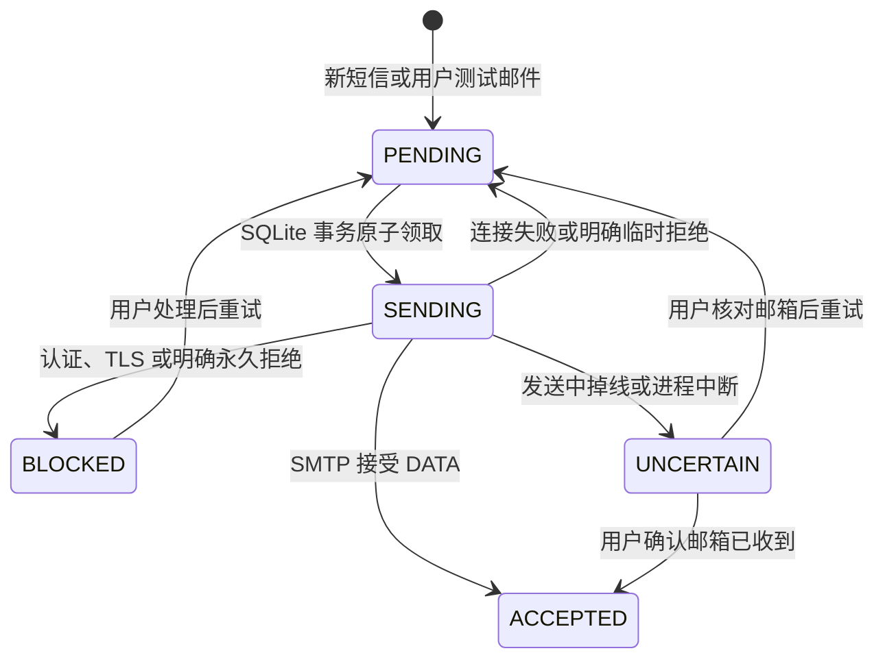

# 信渡 · SMS Ferry 实现地图

核对日期：2026-10-14。安卓个人自用接收端，目标三星 S21 / One UI 7。授权范围与行为约定见 [邮件第一版设计](docs/email-design.md)，安装与验收见 [README](README.md)。

应用显示名为“信渡”，Gradle 项目名为 `SmsFerry`；包名 / applicationId 保持 `com.sobigrice.smsrelay`，兼容原有安装及加密配置。邮件标题前缀与发件人显示名同步为“信渡”。`deliverables/` 是不随源码发布的本地验收记录。

## 入口与职责

| 文件 / 符号 | 职责 |
|---|---|
| `MainActivity` | 运行状态、脱敏邮箱摘要、设置入口、开始/暂停、权限检查、记录核对 |
| `MailSettingsActivity` | 独立邮箱设置，默认只读；显式编辑/保存、取消草稿、用已保存配置发测试邮件 |
| `Readiness` / `Context.readiness` | 短信双权限、通知权限/总开关/频道、电池优化豁免、系统后台限制；区分必需权限与建议 |
| `RelayApp` / `RelayGraph` | 进程级依赖；进程启动时把遗留 sending 标成 uncertain |
| `SmsReceiver` | 受保护的短信广播触发 InboxWorker，不解析通知、不直接发信 |
| `RelayService` | remoteMessaging 前台通知；监听系统短信收件箱变化 |
| `BootReceiver` | 开机首次解锁后 / APK 更新后，恢复原来已经开启的转发 |
| `QueueScheduler` | 独立的收件箱任务、联网发信任务、15 分钟补查 |
| `InboxWorker` / `SmsInbox.scan` | 按 provider `_id` 递增扫描；暂停/重新开启代际变化使旧扫描停止 |
| `QueueDatabase` | 加密记录、唯一 source_id、扫描游标、原子领取、状态与 30 天清理 |
| `SendWorker` / `QueueRunner.run` | 每轮最多 5 条，暂停及取消检查，认证阻塞，退避与结果不明 |
| `QqMailSender` | 固定 QQ TLS SMTP、MIME UTF-8 正文、稳定 Message-ID、失败分类 |
| `CryptoStore` / `ConfigStore` | Keystore AES-GCM；配置加密，开启状态和安全错误码持久化 |

## 接收链路

```text
用户保存设置 → 请求 READ_SMS / RECEIVE_SMS → 查询现有最大收件箱 _id
→ setScanBaseline → config.enabled = true → RelayService + 周期恢复

SMS_RECEIVED / 收件箱变化 / 周期恢复 / 手动补查
→ InboxWorker → SmsInbox.scan(_id > cursor)
→ QueueDatabase.enqueue(加密内容、入队时邮箱目的地)
→ 原子写入记录及游标 → SendWorker（要求联网）
```

系统短信收件箱是事实来源，避免广播和补查各自解析产生两套短信身份。普通广播可能早于默认短信应用落盘，所以该事件允许两次退避复查。广播扫描使用独立 `sms-broadcast-scan` 工作链；收件箱观察、手动补查使用 `sms-inbox-scan`，避免广播退避挡住已经落盘的短信。两条链仍通过数据库唯一 source_id 和原子游标保证导入去重，发信仍在同一串行工作链。暂停同时取消两条扫描链与周期任务。系统调度仍可能延后执行。

不按正文去重；两个不同 provider ID 的相同短信各自保留。首次开启和暂停后恢复均以当前最大 provider ID 为新基线，不补发暂停期间或安装前的历史短信。之前已入队的记录不清除。系统短信不会被本应用修改或删除。

## 配置交互

```text
首页（无邮箱输入框） → 查看邮箱设置（只读） → 编辑配置（内存草稿）
→ 保存：校验并 ConfigStore.save → 回到只读
→ 取消 / 返回：丢弃草稿，已保存配置不变
首次无配置：直接进入编辑，省去空只读页
```

只有 `MailSettingsActivity.saveSettings` 可以从界面写入邮箱配置；测试按钮在编辑中禁用且处理函数也拒绝发送。`MainActivity.withSavedAccount` 和 `MailSettingsActivity.sendSavedAccountTest` 仅读取已保存账号，不暗中保存表单，也不因测试/开始转发清除认证故障。授权码始终不回填，留空只对同一发件地址沿用已保存授权码；只读页面仅显示“已加密保存”。首页地址脱敏，设置只读摘要显示完整地址便于核对。

显式保存保留原有认证故障恢复规则：只允许同一发件账号的 AUTH/TLS/CONFIG 已知未接受记录恢复待发送；UNCERTAIN 和旧队列目的地保持原语义。编辑、取消和保存均不改变开启状态、扫描基线或已有队列内容。

## 运行检查与精简界面

`MainActivity.onResume` 和队列状态广播 → `render` → `Context.readiness`。短信读取/接收分别检查；运行通知同时检查 Android 13+ 权限、应用通知总开关与 `sms-forwarding` 频道；后台项检查电池优化白名单及 Android 9+ `isBackgroundRestricted`。这些都是本应用的公开系统状态，三星从不休眠名单单独说明并由用户确认。没有新增权限或后台轮询。

| 点击入口 | 行为 |
|---|---|
| 开始转发，邮箱未配置 | 直接进入首次编辑，已有配置仍默认只读 |
| 开始转发，有缺失且可申请的权限 | 系统申请未允许的短信权限及可申请的运行通知；短信允许后自动开始 |
| 短信授权已被永久拒绝 | 进入应用权限设置，返回自动刷新检查结果 |
| 运行通知缺失 | 申请通知权限，或按实际阻塞位置进入应用/频道通知设置 |
| 后台限制 / 电池优化未豁免 | 进入应用设置 / 系统电池优化列表；返回刷新 |
| 已开启时重新允许短信权限 | 恢复服务观察与扫描，保持原扫描游标，避免重设基线遗漏短信 |

`permission_prompts` 仅记录每项权限是否曾请求，结合系统 `shouldShowRequestPermissionRationale` 引导永久拒绝情况；不包含邮箱或短信。通知拒绝不阻断 SMS 转发，后台优化提示也不作为新的硬门槛。权限对话框中的开始意图在 Activity 重建时保存。

首页只展示最近 5 条，更多入口仍保留原来的最近 20 条；点击记录显示完整时间、尝试次数与安全错误码。问题处理继续使用原有 `showProblems`，队列记录、目的地、去重和结果不明处理不变。颜色、按钮与字段样式集中于 `res/values/colors.xml` / `styles.xml`；两页统一使用浅色卡片和紧凑布局。

## 邮件状态



`ACCEPTED` 是服务器接受（或用户人工确认邮箱收到），不代表 iPhone 已读。DATA 结果不明不自动重发，邮件系统不提供 exactly-once 保证。稳定 Message-ID 只是额外辨识信息，不保证邮箱去重。

邮箱授权码改变后，仅已知未接受的 AUTH/TLS/CONFIG 阻塞记录允许安全恢复；结果不明仍需人工确认。排队时的目的地固定。换发件账号时旧记录会提示恢复原账号，不自动用新账号发送。暂停允许当前已经开始的 SMTP 完成，之后不再领取 SMS；用户主动排队的测试邮件仍可发。

## 验证定位

- `app/src/test/.../QueueRunnerTest`：相同正文、退避、结果不明、认证、目的地、暂停、取消、批次。
- `MailValidationTest`：地址头注入、授权码、长 Unicode MIME。
- `SmtpIntegrationTest`：本地 TLS 服务、服务器接受、认证拒绝、DATA 后断线、证书和主机名校验，不访问真实邮箱。
- `app/src/androidTest/.../QueueDatabaseTest`：真实 SQLite 并发和唯一 ID、Keystore、篡改、崩溃恢复。
- `SmsInboxTest`：隔离模拟器注入短信，真实 provider 查询、相同正文双记录、游标和历史隔离。
- `AndroidMailTest`：Android 上 Angus provider 与 Unicode MIME，不联网。
- `LocalPipelineTest`：隔离模拟器后台导入，故意设置 AUTH 阻塞以确保不访问 QQ SMTP。
- `QueueSchedulerTest`：早到广播等待重试时，收件箱变化扫描仍可完成；暂停取消广播复查。只在隔离模拟器、假账号和 AUTH 阻塞下执行。
- `MailSettingsUiTest`：默认只读、首次直接编辑、取消/返回丢弃草稿、编辑中禁止测试、显式保存，以及开始转发不重写账号/清除故障。只在隔离模拟器执行。
- `ReadinessTest`：短信双权限、通知权限/总开关/频道、后台限制与电池豁免组合，建议项计数；通知缺失不阻断短信接收。

S21 安装、用户 0 权限、真实普通短信经 QQ 投递及短时锁屏收信已核实。拔掉 USB 后深度休眠、锁屏过夜、真实验证码、长短信与 iPhone 通知时延仍待单独验收。具体执行结果见 `deliverables/verification.md`。
